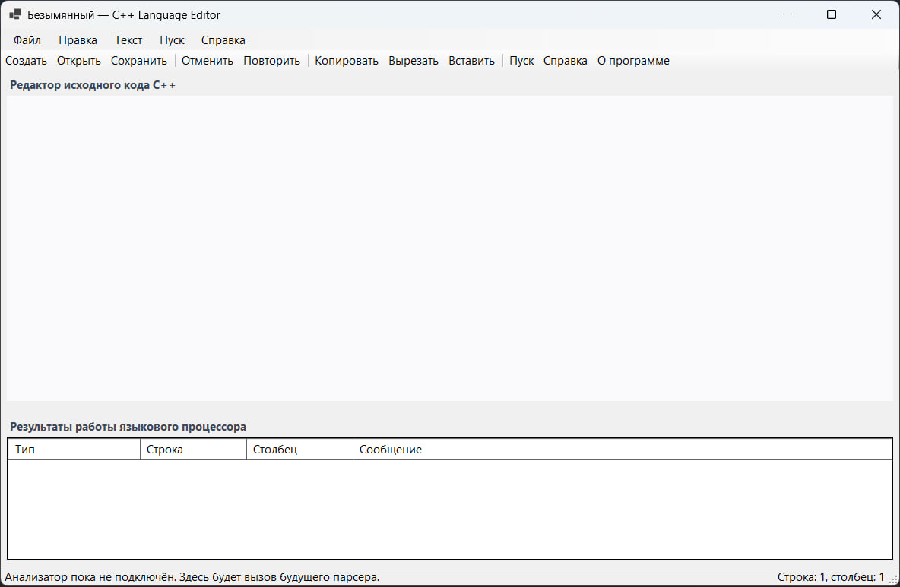
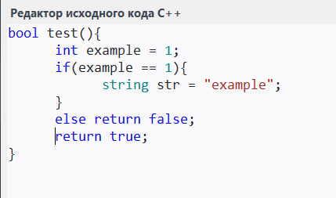
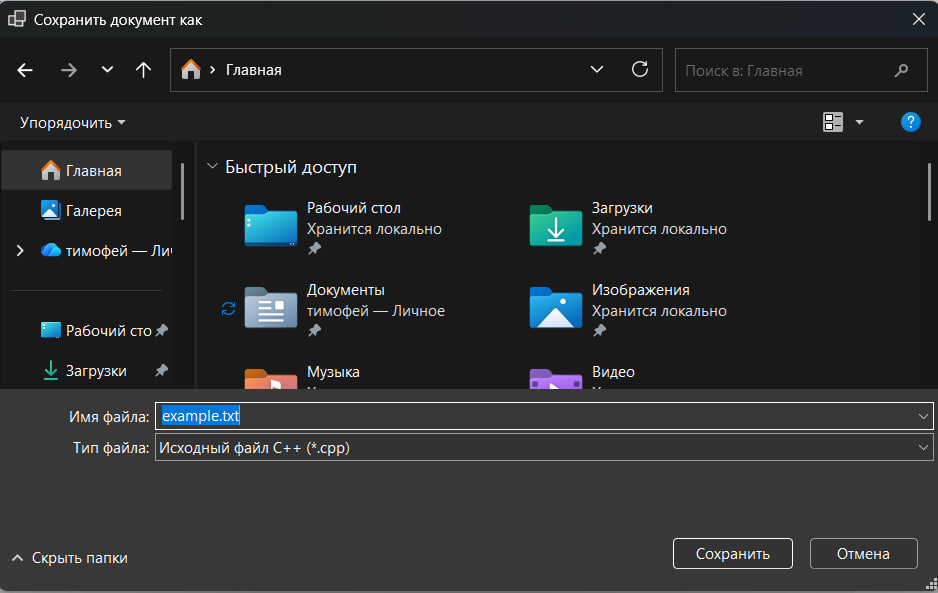
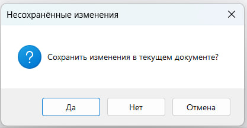
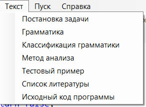
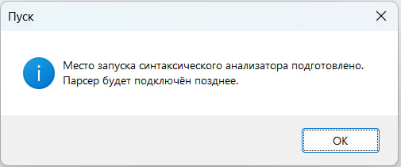
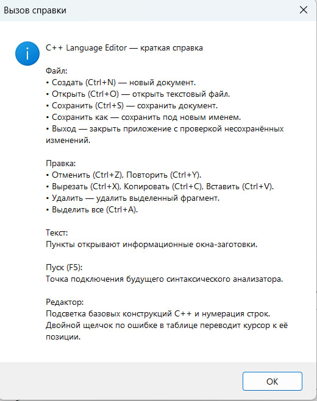
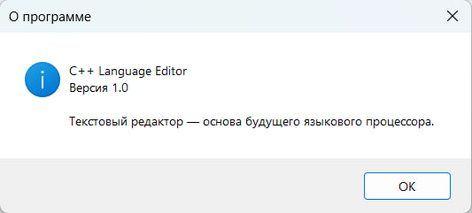

# C++ Language Editor

**Руководство пользователя и краткое описание проекта**  
**Версия приложения:** 1.0 (указана в окне «О программе»)  
**Технологии:** C#, .NET 8, Windows Forms  
**Назначение:** учебный редактор исходного кода C++ и основа для дальнейшей разработки языкового процессора.

> **Текущее состояние.** Редактирование файлов и подсветка основных конструкций C++ уже реализованы. Вызов синтаксического анализатора, отображение реальных результатов анализа и содержательные материалы в меню «Текст» пока находятся на этапе подготовки. Приложение **не компилирует и не выполняет C++-код**.



*Рисунок 1 — Главное окно программы после запуска: меню и панель команд, редактор, область результатов и строка состояния.*

## Содержание

1. [Для чего предназначен редактор](#1-для-чего-предназначен-редактор)
2. [Системные требования и запуск](#2-системные-требования-и-запуск)
3. [Устройство главного окна](#3-устройство-главного-окна)
4. [Первое знакомство с программой](#4-первое-знакомство-с-программой)
5. [Создание, открытие и сохранение файлов](#5-создание-открытие-и-сохранение-файлов)
6. [Работа с редактором исходного кода](#6-работа-с-редактором-исходного-кода)
7. [Меню и панель инструментов](#7-меню-и-панель-инструментов)
8. [Область результатов и запуск анализа](#8-область-результатов-и-запуск-анализа)
9. [Справочная информация](#9-справочная-информация)
10. [Горячие клавиши](#10-горячие-клавиши)
11. [Устройство проекта](#11-устройство-проекта)
12. [Что уже работает и что планируется](#12-что-уже-работает-и-что-планируется)
13. [Скриншоты для документации](#13-скриншоты-для-документации)

## 1. Для чего предназначен редактор

**C++ Language Editor** — настольное Windows-приложение для набора и редактирования текста программ на C++. Оно разрабатывается как пользовательская оболочка будущего языкового процессора: в верхней части окна располагается поле для кода, а в нижней предусмотрена таблица диагностических сообщений.

На текущем этапе пользователь может работать с текстовыми файлами, пользоваться обычными операциями редактирования, видеть цветовое выделение элементов C++ и подготавливать фрагменты к последующему анализу. Для этого не требуется устанавливать отдельный редактор исходного кода.

**Важно различать языки:** программа **написана на C#**, а редактировать в ней предполагается **исходный код C++**. Это не среда для компиляции C++ и не готовый синтаксический анализатор.

Основные возможности текущей версии:

- создание нового документа, открытие существующего файла и сохранение изменений;
- отдельная команда «Сохранить как»;
- предупреждение о несохранённых изменениях;
- подсветка ключевых слов, типов, литералов, комментариев и директив препроцессора;
- отмена и повтор действий, работа с буфером обмена;
- открытие файла перетаскиванием в окно приложения;
- строка состояния с текущими строкой и столбцом курсора;
- подготовленная таблица результатов и интерфейс для перехода к позиции ошибки;
- встроенная краткая справка и сведения о программе.

## 2. Системные требования и запуск

### 2.1. Необходимое окружение

| Компонент | Требование |
| --- | --- |
| Операционная система | Windows с поддержкой .NET 8 Windows Forms (для учебного использования — Windows 10/11) |
| Платформа | .NET 8; в файле проекта указан `net8.0-windows` |
| Интерфейс | Windows Forms (WinForms) |
| Средства разработки | Visual Studio с компонентом **.NET desktop development** либо .NET 8 SDK |
| Дополнительные NuGet-пакеты | В приложенном файле проекта не объявлены |

Для запуска приложения в виде обычной сборки (`framework-dependent`) нужен установленный **.NET 8 Desktop Runtime**. При публикации с параметром `--self-contained true` его установка на целевой компьютер не требуется. SDK необходим для сборки, но не обязателен для запуска уже опубликованного приложения.

Официальная страница .NET: https://dotnet.microsoft.com/download/dotnet/8.0

### 2.2. Запуск через Visual Studio

1. Распакуйте архив проекта в выбранный каталог.
2. Откройте `CppLanguageEditor.csproj` в Visual Studio (либо совместимую с используемой версией Visual Studio `CppLanguageEditor.slnx`).
3. Убедитесь, что установлен набор компонентов **.NET desktop development**.
4. Выберите проект `CppLanguageEditor` для запуска.
5. Нажмите **F5** для запуска с отладкой или **Ctrl+F5** для запуска без отладки.

Команда **F5 внутри самого редактора** имеет другое назначение: вызывает заготовку запуска анализатора. Не путайте её с запуском проекта из Visual Studio.

### 2.3. Сборка и запуск через терминал Windows

Откройте PowerShell или другой терминал в каталоге, содержащем `CppLanguageEditor.csproj`:

```powershell
dotnet restore
dotnet build -c Release
dotnet run -c Release
```

После сборки исполняемый файл обычно располагается по пути:

```text
bin\Release\net8.0-windows\CppLanguageEditor.exe
```

### 2.4. Создание переносимой сборки

Чтобы опубликовать приложение для 64-разрядной Windows вместе с .NET Runtime, выполните:

```powershell
dotnet publish -c Release -r win-x64 --self-contained true
```

Результат по умолчанию находится в каталоге:

```text
bin\Release\net8.0-windows\win-x64\publish\
```

Для переноса на другой компьютер нужно скопировать **всю папку `publish`**, а не только `.exe`. Проект не содержит отдельного установщика.

## 3. Устройство главного окна

После запуска создаётся пустой документ с именем **«Безымянный»**. Окно приложения состоит из нескольких частей.

| Область | Что находится внутри |
| --- | --- |
| Заголовок | Имя текущего файла и `C++ Language Editor`; символ `*` означает несохранённые изменения |
| Главное меню | Разделы «Файл», «Правка», «Текст», «Пуск», «Справка» |
| Панель инструментов | Текстовые кнопки основных операций: создание, открытие, сохранение, редактирование, пуск, справка |
| Верхняя рабочая область | Поле «Редактор исходного кода C++» для ввода и изменения текста |
| Нижняя рабочая область | Таблица «Результаты работы языкового процессора» |
| Строка состояния | Сообщение о последнем действии и позиция курсора (`Строка: ..., столбец: ...`) |

Между редактором и таблицей расположен **горизонтальный разделитель**. Его можно передвигать мышью, увеличивая место для кода или диагностических сообщений.

В текущей реализации **отдельной колонки с номерами строк слева от текста нет**: строка и столбец курсора выводятся внизу окна. Одновременно редактируется один документ; вкладки и работа с несколькими открытыми файлами не реализованы.

## 4. Первое знакомство с программой

Ниже приведён небольшой сценарий, позволяющий проверить основные функции без подключения будущего парсера.

1. Запустите C++ Language Editor. В верхней части увидите пустой редактор.
2. Щёлкните внутри поля ввода и вставьте пример:
```cpp
bool test(){
    int example = 1;
    if(example == 1){
        string str = "example";
    }
    else return false;
    return true;
}
```
3. Посмотрите на подсветку ключевых слов `int`, `if`, `else`, чисел и комментария.
4. Измените любое значение, например `1` на `25`. Рядом с именем документа в заголовке появится `*`.
5. Нажмите **Ctrl+S**, выберите каталог и сохраните документ как `example.cpp`.
6. Для проверки загрузки закройте и заново откройте файл через **Файл → Открыть**.
7. Нажмите **F5** уже в самом приложении. Появится информационное окно о том, что анализатор будет подключён позднее. Проверки синтаксиса пока не произойдёт.



*Рисунок 2 — Фрагмент C++ с комментариями, ключевыми словами, числовыми значениями и изменённым текстом.*

## 5. Создание, открытие и сохранение файлов

### Создание документа

Выберите **Файл → Создать**, нажмите кнопку «Создать» на панели или используйте **Ctrl+N**. Текущий текст будет заменён пустым документом «Безымянный». Если в предыдущем документе есть несохранённые изменения, программа предварительно предложит решить, что с ними делать.

### Открытие существующего документа

Выберите **Файл → Открыть** (или **Ctrl+O**), найдите файл в системном диалоге и подтвердите выбор. Доступны фильтры:

- исходные файлы C++: `*.cpp`, `*.h`, `*.hpp`, `*.cc`;
- текстовые файлы: `*.txt`;
- все файлы: `*.*`.

Фильтры предназначены только для удобства выбора. Программа открывает содержимое как текст; сама по себе операция открытия **не проверяет правильность C++**. При успешном открытии имя файла отображается в заголовке окна.

**Перетаскивание:** можно перетащить локальный файл из Проводника на главное окно программы. Из переданного списка приложение выбирает первый путь. Перед заменой изменённого документа запрашивается подтверждение.

### Сохранение

Выберите **Файл → Сохранить** или нажмите **Ctrl+S**. Если файл уже открывался с диска либо был сохранён ранее, содержимое записывается в него. При первом сохранении появляется диалог для выбора места и имени.

Команда **Файл → Сохранить как** всегда открывает диалог выбора нового имени. В нём предлагаются типы `*.cpp`, `*.h`, `*.txt` и «Все файлы». По умолчанию указано расширение `.cpp`.



*Рисунок 3 — Диалог «Сохранить как»: выбор каталога, имени и расширения документа.*

### Защита от потери изменений

Если содержимое документа менялось, в заголовке появляется звёздочка `*`. При создании другого файла, открытии файла и закрытии окна программа задаёт вопрос **«Сохранить изменения в текущем документе?»**.

- **Да** — попытаться сохранить изменения, затем продолжить действие.
- **Нет** — продолжить без сохранения текущих изменений.
- **Отмена** — оставить текущий документ открытым и отказаться от действия.

Если пользователь выбирает сохранение, но затем отменяет выбор имени файла либо запись не завершается, операция замены документа или закрытия также отменяется.



*Рисунок 4 — Запрос сохранения перед закрытием окна или открытием другого файла.*

**Примечание.** Автосохранение и восстановление после аварийного завершения в проекте не предусмотрены; важные изменения следует сохранять вручную.

## 6. Работа с редактором исходного кода

Редактор построен на `RichTextBox` внутри пользовательского элемента `CppEditor`. По умолчанию используется моноширинный шрифт **Consolas, 11 pt**, перенос длинных строк отключён, доступна горизонтальная и вертикальная прокрутка. Поле допускает табуляцию.

### Подсветка синтаксиса

При вводе текста программа распознаёт с помощью регулярных выражений следующие группы:

| Группа | Примеры | Цвет в исходном коде |
| --- | --- | --- |
| Ключевые слова C++ | `if`, `else`, `class`, `return`, `int`, `auto` | Синий |
| Распространённые имена типов и стандартных сущностей | `string`, `vector`, `cout`, `size_t` | Бирюзовый (`Teal`) |
| Числовые литералы | `42`, `3.14`, `0xFF` | Тёмно-бирюзовый (`DarkCyan`) |
| Строковые и символьные литералы | `"hello"`, `'x'` | Коричневый |
| Комментарии | `// ...`, `/* ... */` | Зелёный |
| Директивы препроцессора | `#include`, `#define` | Фиолетовый (`MediumPurple`) |

Чтобы не перерисовывать текст при каждом нажатии клавиши, обновление подсветки откладывается примерно на **200 мс** после изменения. Оформление применяется в видимой области редактора с дополнительным запасом строк и старается сохранять положение курсора и прокрутку.

**Ограничение:** подсветка основана на регулярных выражениях, а не на полноценном разборе программы. Поэтому цвет текста не доказывает, что написанная конструкция синтаксически верна.

### Редактирование и история изменений

Доступны отмена и повтор действий, вырезание, копирование, вставка, удаление выделенного текста и выделение всего документа. Внутри `CppEditor` история реализована через сохранение снимков текста и положения выделения. Последовательные изменения группируются по паузе ввода около **600 мс**.

Позиция курсора выводится в строке состояния. Нумерация начинается с **1** и для строк, и для столбцов.

## 7. Меню и панель инструментов

### «Файл»

Команды: **Создать**, **Открыть**, **Сохранить**, **Сохранить как**, **Выход**. Они отвечают за жизненный цикл одного открытого документа.

### «Правка»

Команды: **Отменить**, **Повторить**, **Вырезать**, **Копировать**, **Вставить**, **Удалить**, **Выделить все**. Основные действия также вынесены на панель инструментов.

### «Текст»

Раздел предназначен для материалов по разрабатываемому языковому процессору. В этой версии он содержит семь пунктов:

1. Постановка задачи.
2. Грамматика.
3. Классификация грамматики.
4. Метод анализа.
5. Тестовый пример.
6. Список литературы.
7. Исходный код программы.

**Текущее поведение всех семи пунктов одинаковое:** открывается информационное окно о том, что соответствующий раздел будет заполнен на следующем этапе. В частности, **«Тестовый пример» пока не вставляет код в редактор**.



*Рисунок 5 — Список разделов меню «Текст», подготовленных для учебных и справочных материалов.*

### «Пуск»

Вызывает функцию `RunAnalyzerPlaceholder()`. Она меняет сообщение в строке состояния и показывает уведомление о будущей интеграции синтаксического анализатора. В текущей версии запуск **не выполняет разбор C++-кода**.

### «Справка»

Предоставляет команды **Вызов справки** и **О программе**. Обе доступны также на панели инструментов.

Кнопки панели инструментов подписаны текстом, а при наведении отображают подсказки.

## 8. Область результатов и запуск анализа

Нижняя таблица — подготовленная часть интерфейса будущего языкового процессора. Она содержит четыре столбца:

| Столбец | Назначение |
| --- | --- |
| Тип | Уровень диагностического сообщения, например «Ошибка» |
| Строка | Номер строки исходного текста |
| Столбец | Позиция в строке |
| Сообщение | Описание обнаруженной проблемы |

Таблица доступна только для чтения. В ней не предусмотрено ручное добавление строк пользователем. При создании или успешном открытии файла прежние диагностические сообщения очищаются.

В коде уже предусмотрены методы `AddError(...)`, `ClearErrors()` и `HighlightError(...)`. Модель `EditorError` содержит поля `Line`, `Column`, `Length`, `Message`, `Severity`. Если программно добавить сообщение об ошибке, **двойной щелчок по его строке** переводит курсор в соответствующую позицию редактора и выделяет проблемный фрагмент.

Однако **автоматического заполнения таблицы пока нет**: команда **Пуск (F5)** не создаёт диагностических записей, а показывает информационный диалог.



*Рисунок 6 — Реакция текущей версии на запуск анализа: информационное окно вместо результата работы парсера.*

## 9. Справочная информация

**Справка → Вызов справки** или **F1** открывает окно с кратким описанием файловых команд, редактирования, меню «Текст» и назначения кнопки «Пуск».

**Справка → О программе** показывает название **C++ Language Editor**, версию **1.0** и пояснение, что приложение является основой будущего языкового процессора.



*Рисунок 7 — Окно встроенной справки с описанием доступных команд.*



*Рисунок 8 — Информация о версии программы и её назначении.*

## 10. Горячие клавиши

| Действие | Сочетание |
| --- | --- |
| Создать документ | `Ctrl+N` |
| Открыть документ | `Ctrl+O` |
| Сохранить | `Ctrl+S` |
| Отменить | `Ctrl+Z` |
| Повторить | `Ctrl+Y` |
| Вырезать | `Ctrl+X` |
| Копировать | `Ctrl+C` |
| Вставить | `Ctrl+V` |
| Удалить выделенный фрагмент | `Delete` (команда меню) |
| Выделить всё | `Ctrl+A` |
| Вызвать заготовку анализа | `F5` |
| Открыть справку | `F1` |

Для **«Сохранить как»** отдельное сочетание клавиш в исходном коде не назначено: используйте меню **Файл → Сохранить как**.

## 11. Устройство проекта

Исходники организованы в небольшую структуру:

```text
CppLanguageEditor/
├── CppLanguageEditor.csproj   — настройки сборки .NET 8 / WinForms
├── CppLanguageEditor.slnx     — файл решения Visual Studio
├── Program.cs                 — точка входа приложения
├── MainForm.cs                — основное окно, меню и операции с файлами
├── Controls/
│   └── CppEditor.cs           — компонент редактирования и подсветки C++
├── Models/
│   └── EditorError.cs         — модель диагностического сообщения
├── README.md                  — исходное краткое описание
├── bin/                       — результаты локальной сборки
└── obj/                       — промежуточные файлы сборки
```

**`Program.cs`** инициализирует Windows Forms и запускает `MainForm`.  
**`MainForm.cs`** формирует главное окно, меню, панель инструментов, таблицу результатов, обрабатывает открытие/сохранение документов и команды пользователя.  
**`CppEditor.cs`** инкапсулирует `RichTextBox`, регулярные выражения для подсветки, историю редактирования, переход к позиции и выделение ошибок.  
**`EditorError.cs`** задаёт данные о диагностическом сообщении, которые впоследствии сможет выдавать парсер.

Каталоги `bin/` и `obj/` создаются средствами .NET при сборке; к основному исходному коду приложения не относятся. В исходном архиве отдельного проекта автоматических тестов нет.

## 12. Что уже работает и что планируется

### Реализовано в представленном исходном коде

- Графическое окно для работы с одним документом C++.
- Основные команды файлового меню и защита от случайной потери изменений.
- Ввод и редактирование текста с историей отмены и повтора.
- Цветовое оформление распространённых элементов C++.
- Отображение позиции курсора и возможность менять размеры рабочих областей.
- Таблица сообщений и методы, необходимые для будущей интеграции диагностик.
- Встроенная краткая справка, информация о версии и клавиатурные команды.

### Пока не реализовано

- Лексический и синтаксический анализ с сообщениями о реальных ошибках.
- Автоматическое заполнение таблицы после нажатия **F5**.
- Проверка грамматики или выполнение/компиляция C++-программ.
- Заполненные теоретические материалы меню «Текст» и автоматическая вставка тестового примера.
- Отдельная колонка с номерами строк, вкладки документов, автосохранение.
- Поставка установщика и автоматические тесты в приложенном архиве.

### Возможное дальнейшее развитие

Следующим этапом может стать подключение лексического и синтаксического анализатора: получение текста из `CppEditor`, преобразование результатов проверки в объекты `EditorError`, добавление их через `AddError(...)` и подсветка найденных ошибок. После реализации анализа разделы «Грамматика», «Метод анализа» и «Тестовый пример» можно заполнить фактическими материалами и примерами. **Это план развития, а не функции текущей версии.**